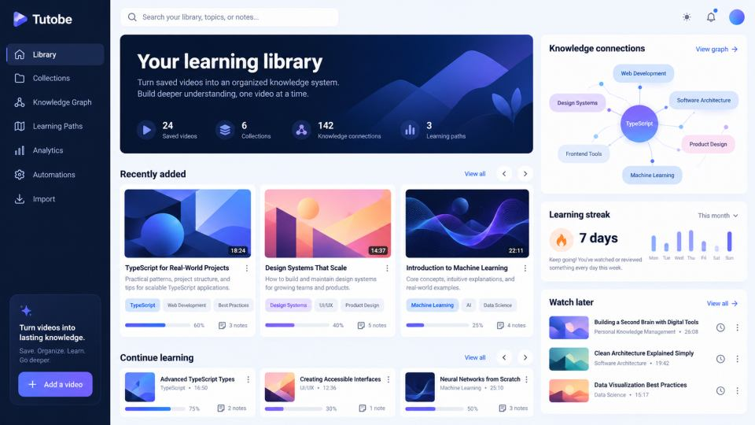
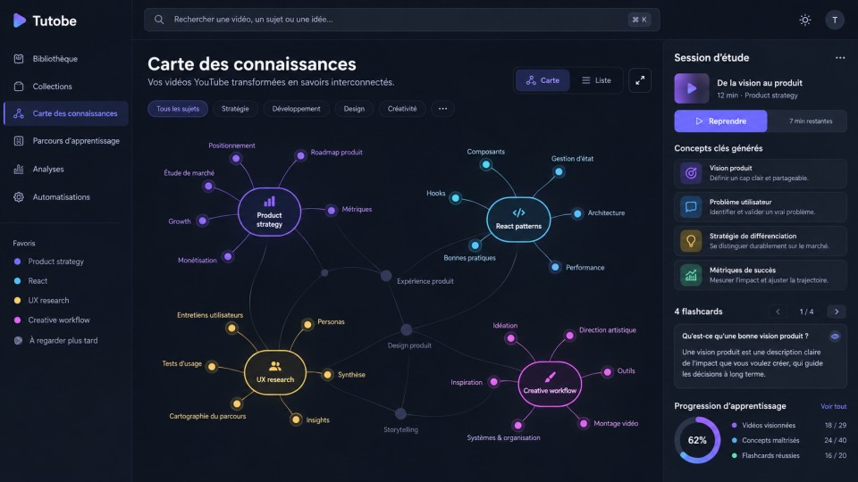

# Tutobe

### La bibliothèque YouTube qui transforme ce que vous regardez en ce que vous retenez.

**Tutobe est un espace personnel pour importer, organiser, relier et réutiliser les vidéos qui comptent. Il remplace l’accumulation de liens par une bibliothèque de connaissance vivante.**

[Ouvrir Tutobe](https://tutobe.vercel.app) · [Découvrir les fonctionnalités](#ce-que-tutobe-permet) · [Signaler un problème](../../issues)

 

---

> **Ce n’est pas une playlist de plus.** Tutobe donne un contexte à chaque vidéo : pourquoi elle est là, à quel sujet elle appartient, avec quoi elle se relie et quelle action elle peut nourrir.

  
   
  Aperçu produit avec données de démonstration anonymisées.

  
   
  Carte de connaissances et espace d’étude — données de démonstration anonymisées.

## Le problème que Tutobe résout

YouTube est l’une des meilleures sources pour apprendre, créer et faire de la veille. Pourtant, après quelques semaines, les vidéos sauvegardées deviennent difficiles à exploiter : elles sont dispersées entre favoris, historique et playlists ; elles manquent de notes ; leurs liens thématiques restent invisibles.

Tutobe apporte une couche de mémoire et d’organisation au-dessus de votre consommation vidéo.

| Sans système | Avec Tutobe |
| --- | --- |
| « Je sais que j’ai vu une bonne vidéo là-dessus. » | Retrouvez-la par titre, chaîne, sujet, tag, catégorie ou note. |
| Des vidéos isolées dans des playlists. | Des ressources reliées dans un graphe de connaissances. |
| Une liste qui s’allonge. | Des collections, parcours et priorités qui donnent une direction. |
| De bonnes intentions d’apprentissage. | Une progression visible, des notes et des prochaines actions. |

## Ce que Tutobe permet

### Une bibliothèque construite autour de votre façon de penser

- **Catalogue centralisé** — importez, créez, éditez et enrichissez chaque vidéo.
- **Organisation fine** — catégories, tags, collections, playlists, favoris, notes et historique de visionnage.
- **Vues adaptées au contexte** — basculez entre grille, liste, table, kanban, chronologie et calendrier.
- **Recherche avancée** — combinez texte, catégorie, tags, chaînes, dates, état, favoris et autres critères.
- **Filtres et recherches enregistrés** — retrouvez instantanément les ensembles que vous consultez souvent.

### Un système de connaissance, pas seulement de classement

Tutobe rapproche les vidéos qui partagent des thèmes, catégories ou tags et les présente dans un **graphe de connaissances**. Vous pouvez explorer un sujet par son contexte plutôt que par un titre exact, puis créer des **parcours d’apprentissage** pour organiser une progression.

L’espace d’extraction de connaissances aide également à transformer une vidéo en matière exploitable : concepts, points clés, cartes mémoire, mind maps et sessions d’étude. Cette couche d’assistance s’appuie sur les informations que vous classez et contrôlez ; elle est là pour clarifier votre bibliothèque, pas pour remplacer votre jugement.

### Importer sans changer vos habitudes

| Source | Ce que Tutobe fait |
| --- | --- |
| **Extension Chrome** | Lit la sélection de vidéos aimées YouTube depuis votre navigateur puis l’importe dans votre bibliothèque Tutobe authentifiée. |
| **CSV** | Reprend une bibliothèque existante et traite l’import par lots avec une progression réelle. |
| **Ajout manuel** | Permet de constituer une bibliothèque très ciblée, une vidéo à la fois. |

Le moteur détecte les doublons et vous aide à conserver une collection propre dès l’import.

### Donner de l’intelligence au rangement

Tutobe inclut une assistance d’organisation qui reste compréhensible et actionnable :

- propositions de catégories fondées sur le titre, les tags et la chaîne ;
- extraction de tags pertinents depuis les métadonnées ;
- détection de similarités et de doublons ;
- relations dérivées entre contenus pour alimenter le graphe ;
- règles d’automatisation pour classer, signaler ou favoriser des vidéos selon vos critères ;
- outils de maintenance et d’analyse de qualité pour garder la bibliothèque fiable.

### Faire progresser, pas seulement stocker

Analytics, rapports, tendances, tableaux de bord, recommandations, achievements, templates et outils de productivité servent un seul objectif : passer du contenu sauvegardé au contenu réellement utilisé.

## Un produit pensé pour différents usages

**Apprendre un sujet complexe** — centralisez cours, explications et exercices, puis créez votre propre parcours.  
**Faire de la veille** — classez les vidéos importantes par projet, domaine ou priorité et retrouvez-les sans friction.  
**Construire une mémoire créative** — conservez les références, inspirations et techniques avec leur contexte.  
**Gérer une base de ressources professionnelle** — utilisez collections, recherche, statistiques et partage pour rendre la veille exploitable.

## La confiance est une fonctionnalité

Votre bibliothèque est personnelle. Tutobe est conçu pour la protéger à tous les niveaux :

- **Données isolées par utilisateur** grâce à des règles appliquées au niveau de la base de données.
- **Sessions authentifiées de courte durée** plutôt que des identifiants de base exposés au navigateur.
- **Accès Google encadré** : Tutobe ne reçoit ni votre mot de passe ni le contrôle de votre compte YouTube.
- **Import en lecture seule** : aucune vidéo n’est likée, commentée, supprimée ou modifiée en votre nom.
- **Sauvegardes et exports** pour que vos données restent portables et récupérables.

Consultez la [politique de confidentialité](https://tutobe.vercel.app/privacy) et les [conditions d’utilisation](https://tutobe.vercel.app/terms).

## Accéder à Tutobe

[**Ouvrir l’application →**](https://tutobe.vercel.app)

## À propos de ce dépôt

Ce dépôt est la vitrine publique officielle de Tutobe : présentation produit, échanges communautaires et documentation ouverte.

Le code source, l’infrastructure et les données de production restent privés. Tutobe n’est pas un projet open source et ce dépôt ne permet pas d’exécuter l’application localement.

- Une idée produit ou un cas d’usage ? [Ouvrez une discussion](../../discussions).
- Un problème dans l’expérience ou la documentation ? [Créez une issue](../../issues).
- Un sujet de sécurité ? Consultez [SECURITY.md](SECURITY.md).

  © 2026 Tutobe. Tous droits réservés.

